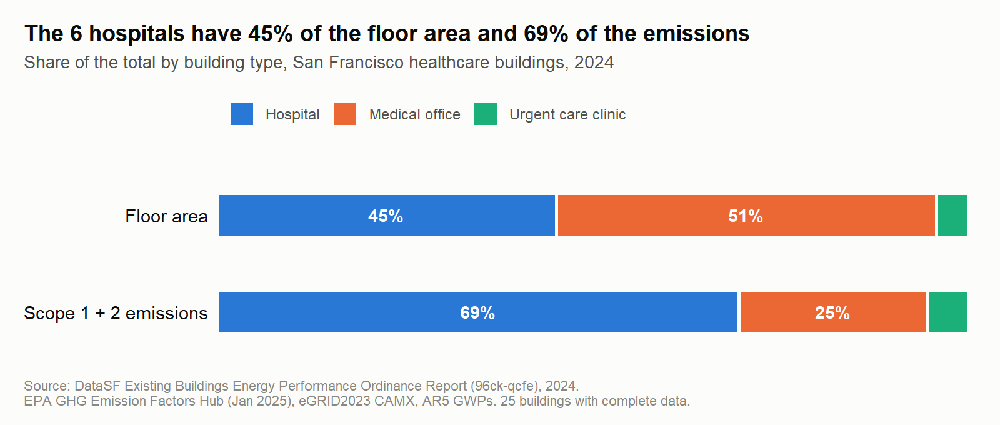
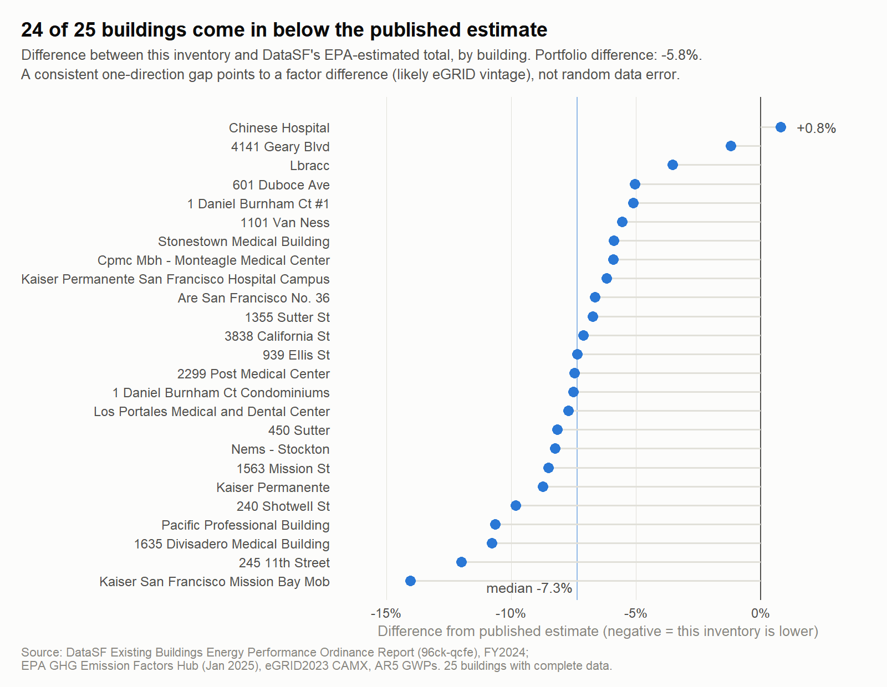
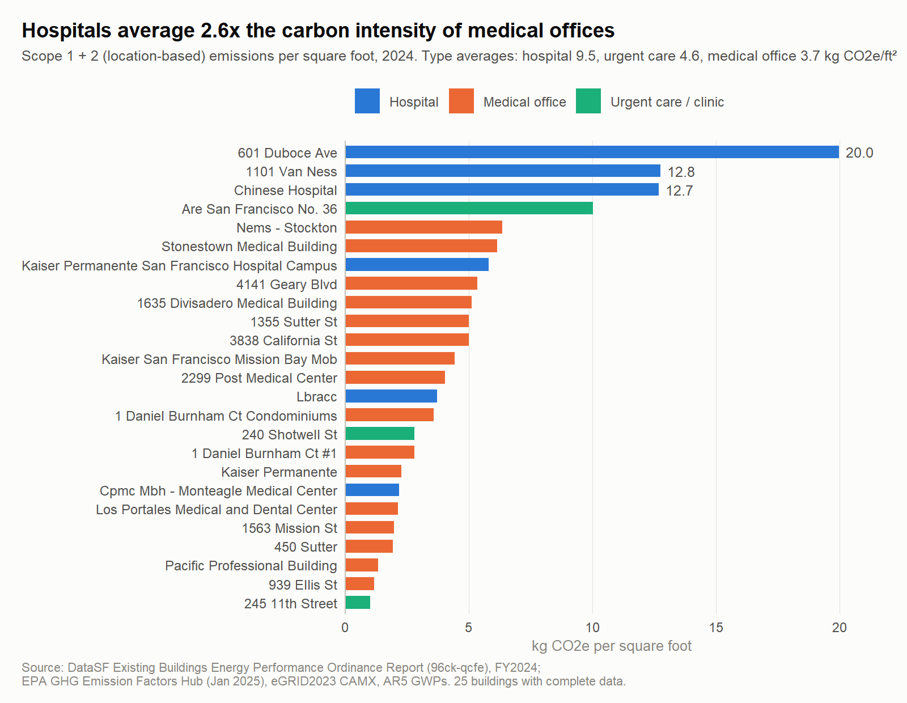

# SF Healthcare Building Portfolio GHG Inventory

Six San Francisco hospitals in this sample produce 69% of the portfolio's
Scope 1 + 2 emissions on 45% of its floor area. The calculated total for the
25 buildings with usable data (32,647 metric tons CO2e) comes in 5.8% below
the city's own EPA-estimated figure for the same buildings.





<details>
<summary>Carbon intensity by building</summary>



</details>

This is an exercise built on public data to
demonstrate a carbon accounting method. It covers 30 San Francisco healthcare facilities (6 hospitals, 4
urgent care/outpatient clinics, 20 medical office buildings) for calendar
year 2024, built from San Francisco's building energy benchmarking
disclosures and EPA/eGRID emission factors.

## What's here

- **[`report/inventory_report.pdf`](report/inventory_report.pdf)** — the
  full inventory: boundary, method, results, reconciliation against the
  published EPA estimate.
- **[`report/inventory_management_plan.pdf`](report/inventory_management_plan.pdf)**
  — the reproducibility procedure.
- **`R/`** — the scripts, in order, from raw download to final table and figures
  (`01_download_data.R`, `02_profile_qa.R`, `03_calculate_emissions.R`, `04_figures.R`).
- **`output/qa_log.csv`** — every data quality issue found, what was done
  about it, and why.
- **`output/emissions_results.csv`** / **`output/portfolio_summary.csv`** —
  per-building and portfolio-level results.
- **`data/`** — raw and cleaned intermediate data.

## Method

Scope 1 (natural gas) and Scope 2 location-based (purchased electricity,
eGRID CAMX subregion) emissions, calculated from San Francisco's Existing
Buildings Energy Performance Ordinance disclosures using EPA's January 2025
GHG Emission Factors Hub (AR5 GWPs). Market-based Scope 2 is explicitly not
reported since building-level clean-energy program enrollment isn't public. Full detail,
including why the calculated total runs below the city's own published
estimate, is in the inventory report.

## Reproducing this

```
Rscript R/01_download_data.R
Rscript R/02_profile_qa.R
Rscript R/03_calculate_emissions.R
Rscript R/04_figures.R
```

Requires R with `httr`, `jsonlite`, `dplyr`, `ggplot2`, and `scales`. Each script reads the
previous step's output from `data/` and writes its own output before the
next step runs.
