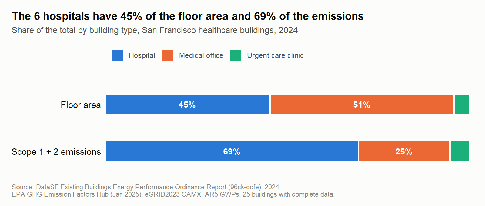
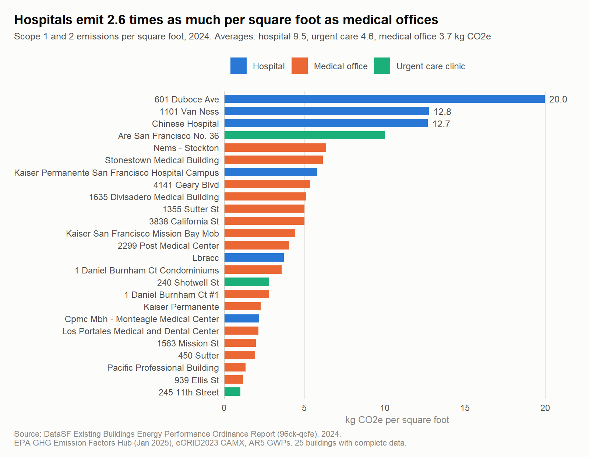
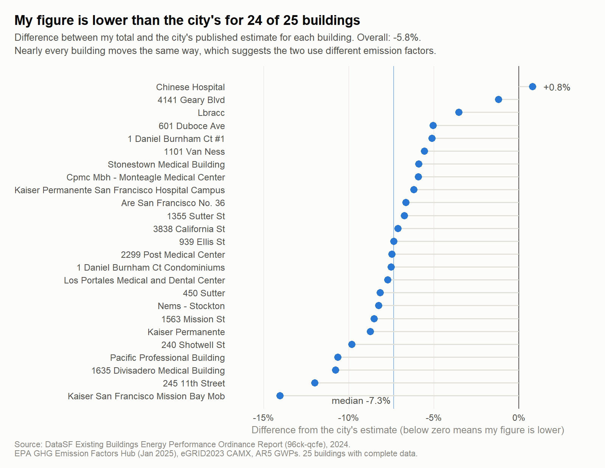

# GHG Inventory: San Francisco Healthcare Buildings, 2024

Garrett Sybers | Portfolio exercise using public data | November 2026

## 1. Summary

This inventory covers Scope 1 and Scope 2 greenhouse gas emissions for 30
San Francisco healthcare buildings in calendar year 2024. The sample has 6
hospitals, 4 urgent care clinics and the 20 largest medical office buildings
in the city's benchmarking data.

The 25 buildings with complete data emitted **32,647 metric tons CO2e**.
Natural gas (Scope 1) accounts for 17,929 t and purchased electricity (Scope
2, location-based) for 14,717 t.

The six hospitals produce 69% of these emissions on 45% of the floor area.
Per square foot, they emit about 2.6 times as much as the medical offices.

My total is 5.8% below the estimate the city publishes for the same
buildings. Section 6 explains the gap. The most likely cause is that the
city's figures use an older electricity emission factor.

I built this on my own from public data to practice carbon accounting
methods. Nobody commissioned it, and no third party has checked it.

## 2. Boundary

**Organizational boundary.** The inventory covers 30 buildings that I
selected from San Francisco's Existing Buildings Energy Performance Ordinance
data (DataSF resource `96ck-qcfe`). No single company owns these buildings,
so the inventory describes a sample of facilities. I
assigned all energy use to the building where it was metered. This follows
an operational control approach. The city publishes energy use per building
and does not split it between tenants and owners.

**Operational boundary.** Scope 1 is natural gas burned on site. Scope 2 is
purchased electricity, reported on a location basis. Scope 3 is not
included. None of the 30 buildings reported district steam, so no steam
factor is used.

**Reporting period.** Calendar year 2024. This is the latest year where
nearly all buildings had filed when I pulled the data. Reports for 2025 were
still coming in.

**Building selection.** The three healthcare categories (hospital, urgent
care, medical office) held 43 buildings, and I wanted 10 to 30. I kept all 6
hospitals and all 4 urgent care clinics because they run around the clock
and use the most energy. I then took the 20 largest medical office
buildings. This cut is my own choice and is documented as such.

## 3. Data Sources

**Energy use.** DataSF, *Existing Buildings Energy Performance Ordinance
Report*, resource `96ck-qcfe`, pulled on 2026-11-20 through the Socrata API
at `https://data.sfgov.org/resource/96ck-qcfe.json`. DataSF describes the
dataset as two tables to be joined on parcel number. When I pulled it, the
two were already merged into one table with one row per building per year,
so no join was needed. That also meant there were no rows lost in a join to
investigate. 43 rows matched the healthcare filter for 2024, and I kept 30.
The file `data/raw/pull_metadata.csv` records the exact query and row
counts.

**Emission factors.** EPA, *GHG Emission Factors Hub*, last modified January
15, 2025.

| Factor | Value | Source in the Hub |
|---|---|---|
| Natural gas, CO2 | 53.06 kg per mmBtu | Table 1 |
| Natural gas, CH4 | 1.0 g per mmBtu | Table 1 |
| Natural gas, N2O | 0.10 g per mmBtu | Table 1 |
| Electricity, CO2 | 436.7 lb per MWh | Table 6, eGRID2023, CAMX subregion |
| Electricity, CH4 | 0.025 lb per MWh | Table 6, eGRID2023, CAMX subregion |
| Electricity, N2O | 0.003 lb per MWh | Table 6, eGRID2023, CAMX subregion |
| GWP, CH4 | 28 | IPCC Fifth Assessment Report (AR5) |
| GWP, N2O | 265 | IPCC Fifth Assessment Report (AR5) |

CAMX is the eGRID subregion that covers San Francisco. EPA had not released
a newer version by the pull date. A third party (Cornerstone) has published
factors based on eGRID2024, but I stayed with the official EPA release.

**Comparison figure.** The same DataSF table includes a `total_ghg_emissions`
value for each building, calculated in ENERGY STAR Portfolio Manager when the
owner submitted their data. I use it only to check my results in Section 6.

## 4. Data Quality Checks

Before calculating anything, I checked every building for duplicate rows,
missing or zero energy values, a missing construction year, and energy use
intensity (EUI) outside a plausible range. I set the plausible range at 100
to 500 kBtu/ft² for hospitals and 25 to 300 for the other types, based on
ENERGY STAR national medians. I flagged problems and did not delete any
rows. The full log is in `output/qa_log.csv` (18 rows).

| Issue | Buildings | What I did |
|---|---|---|
| Did not file a benchmark report | 3 | Left out of totals because there is no data to use |
| Electricity missing or zero | 3 | Left Scope 2 blank for that building |
| Natural gas missing or zero | 5 | Left Scope 1 blank. Some SF buildings are all electric, but I did not assume zero without evidence |
| Construction year missing | 1 | Left blank. Not used in any calculation |
| EUI outside the plausible range | 6 | Kept in the calculation and flagged for review. The data could be correct for an unusual building |

There were no duplicate rows. In the end, 25 of the 30 buildings have both
Scope 1 and Scope 2. The other 5 show as blank in
`output/emissions_results.csv` and are not counted as zero.

## 5. Results

| | Scope 1 (natural gas) | Scope 2, location-based (electricity) | Total |
|---|---|---|---|
| **Metric tons CO2e** | 17,929 | 14,717 | **32,647** |

All totals cover the same 25 buildings, with 5,054,737 ft² of floor area.
Two all-electric buildings (1522 Bush St and the CPMC Pacific Campus Annex)
have electricity data but no gas record. Their Scope 2 (about 96 t together)
appears in the building results but not in the totals. This keeps the totals
and the comparison in Section 6 on the same set of buildings.

**Why there is no market-based Scope 2 figure.** The GHG Protocol asks for
Scope 2 to be reported two ways. The location-based figure above uses the
average emissions of the regional grid. A market-based figure would use the
electricity each building buys. In San Francisco, a building might
buy power from CleanPowerSF, the city's lower-carbon program, or stay on
PG&E's standard rate. That choice is not public for individual buildings. To
calculate a market-based figure, I would need each building's utility account
records, including any renewable energy certificates, or a residual mix
factor for power not covered by a contract. I didn't have either, so I left
the figure out.

**Intensity by building type** (the 25 buildings with complete data)

| Type | Buildings | Average EUI (kBtu/ft²) | Average emissions (kg CO2e/ft²) |
|---|---|---|---|
| Hospital | 6 | 172.9 | 9.52 |
| Urgent care clinic | 3 | 82.4 | 4.62 |
| Medical office | 16 | 65.9 | 3.67 |

Hospitals use about 2.6 times as much energy per square foot as medical
offices and emit about 2.6 times as much. Hospitals run imaging,
sterilization and infection control ventilation all day and night, so a gap
is expected. The range inside each type is wide, though. 601 Duboce Ave
emits 20 kg CO2e/ft², while two hospitals (LBRACC and CPMC Monteagle) emit
less per square foot than several medical offices. The QA log had already
flagged both for low EUI.

## 6. Comparison With the City's Published Estimate

For the same 25 buildings, the city's data gives a total of 34,642 t. My
total of 32,647 t is 5.8% lower. Building by building, the median difference
is -7.3%, and the range is -14.0% to +0.8%. My figure is lower for 24 of the
25 buildings. Chinese Hospital is the only one where it is higher, by 0.8%.

Random errors in the data would push some buildings up and some down. Here
nearly every building moves the same way by a similar amount, which suggests
the two calculations use different emission factors. My best explanation is
that the city's figures were calculated with an eGRID version older than
eGRID2023. California's grid has become cleaner with each eGRID release, so
an older factor would assign more CO2 to each MWh. That would make the city's
estimate higher for almost every building, which is the pattern in the
chart.

I also considered whether different global warming potentials could explain
the gap. If Portfolio Manager uses the older AR4 values, it would rate
methane lower and nitrous oxide higher than I do. In this inventory those
two gases are a small share of the total, so the effect would be small.

Without access to each building's Portfolio Manager account, I can't confirm
which eGRID version each report used. The factor explanation is the one that
best fits the public data, but I have not proven it.

## 7. Uncertainty and Limits

These are listed roughly in order of how much they could change the total.

1. **Self-reported meter data.** All energy figures come from the owners'
   own benchmarking reports. I had no way to check them against utility
   bills.
2. **Missing buildings.** 5 of the 30 buildings (17%) are left out because
   they lack data. If they emit at the sample's average rate per square
   foot, the true 30-building total would be several thousand tons higher.
3. **No market-based Scope 2.** Without each building's power purchase
   records, the location-based figure may be too high or too low for a
   given building.
4. **Emission factor version.** I used one set of factors for the whole
   year. In Section 6, my figures differ from the city's by up to 14% for a
   single building, and the factor version is the most likely cause.

**Rounding.** I round portfolio totals to whole tons. Reporting a figure like
32,646.62 would claim more precision than self-reported meter data and
regional average factors can support.
